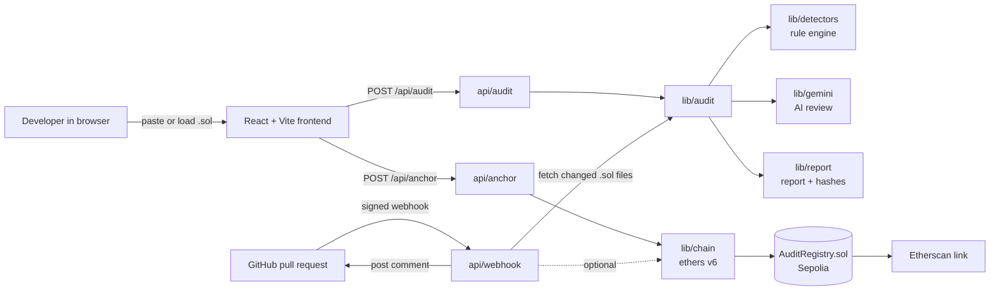

# Contract Auditor

AI-assisted security scanner for Solidity smart contracts. It checks a contract for known vulnerabilities before deployment, produces an audit report, records a tamper-proof fingerprint of the audit on the Sepolia testnet, and re-runs the audit automatically on every GitHub pull request.

Built for **CRECENDO Hackathon by Metapoise V2.0** (DUIET, Dibrugarh University), Track A, problem statement **PS-S02: AI-Powered Smart Contract Auditor**.

- Live demo: https://contract-auditor-solidity.vercel.app/
- AuditRegistry on Sepolia: https://sepolia.etherscan.io/address/0xA7Bf87aEEf7957c77567652b54B482a4Ba8Da35e

## What it does

1. **Detects vulnerabilities** with a rule-based engine and a Gemini AI review, then merges both into one list of findings.
2. **Explains and fixes**: every finding has a severity, line number, explanation and a suggested fix.
3. **Scores and reports**: a 0 to 100 security score and a downloadable Markdown report.
4. **Anchors the audit on-chain**: the keccak256 hashes of the contract and the report are written to an `AuditRegistry` contract on Sepolia, so the audit cannot be altered later.
5. **Audits pull requests**: a signed GitHub webhook scans changed `.sol` files and comments the results on the PR.

This is a first-pass automated auditor. It does not replace a manual audit.

## Architecture



The web app and the webhook share the same `lib/audit` module, so both paths produce identical results.

### Request flow: web audit

1. The user pastes a contract or loads the sample and clicks **Run audit**.
2. `/api/audit` runs the rule detectors, sends the numbered source plus the rule findings to Gemini (forced JSON schema), and merges the results.
3. The frontend shows the score, findings and highlighted lines, and builds the Markdown report.
4. On **Store audit on Sepolia**, `/api/anchor` hashes the contract and report and calls `storeAudit` on the registry. The UI shows the transaction link.

If the server is unreachable (for example in a static preview), the frontend falls back to running the rule checks in the browser and says so.

### Request flow: pull request

1. GitHub sends a `pull_request` event to `/api/webhook`.
2. The signature (`X-Hub-Signature-256`) is verified with HMAC SHA-256.
3. For `opened`, `synchronize` and `reopened`, the function lists changed files, keeps `.sol` files and fetches them at the PR head commit.
4. Each file is audited, and one comment with the score, findings table and fixes is posted on the PR.

## Project structure

```
contract-auditor-solidity/
├── api/                      Vercel serverless functions
│   ├── audit.ts              POST /api/audit: run an audit
│   ├── anchor.ts             POST /api/anchor: write hashes to Sepolia
│   └── webhook.ts            POST /api/webhook: GitHub PR integration
├── lib/                      Shared logic (no framework code)
│   ├── audit.ts              Orchestrates rules + AI, merges, scores
│   ├── detectors.ts          Rule-based vulnerability checks
│   ├── gemini.ts             Gemini call with JSON schema
│   ├── report.ts             Markdown report and keccak256 hashes
│   ├── chain.ts              ethers v6 registry client
│   ├── sample.ts             Deliberately vulnerable demo contract
│   └── types.ts              Shared types
├── contracts/
│   └── AuditRegistry.sol     On-chain audit log (deployed to Sepolia)
├── src/                      React frontend
│   ├── components/
│   │   ├── Header.tsx
│   │   ├── CodePane.tsx      Source view with highlighted lines
│   │   ├── FindingsTab.tsx   Score, severity filters, finding cards
│   │   ├── ReportTab.tsx     Rendered report and download
│   │   ├── OnChainTab.tsx    Hashes, Sepolia write, Etherscan link
│   │   └── NoticeBanner.tsx  Browser-only fallback notice
│   ├── App.tsx
│   ├── main.tsx
│   └── index.css
├── .env.example              Names of required environment variables
├── vercel.json               Build config and SPA rewrite (excludes /api)
├── vite.config.ts
├── tsconfig.json
├── package.json
└── README.md
```

## Vulnerability coverage

| Check | Severity |
|---|---|
| Reentrancy (external call before state update) | Critical |
| Unprotected `selfdestruct` | Critical |
| `tx.origin` used for authorization | High |
| Unprotected `delegatecall` | High |
| Missing access control on sensitive functions | High |
| Integer overflow or underflow (Solidity below 0.8, no SafeMath) | High |
| Unchecked low-level call or `send` return value | Medium |

The Gemini review covers further patterns (front-running, denial of service, timestamp dependence) and writes concrete fixes. Where a rule and the AI agree on the same issue, they are merged into one finding labelled "Rule check + AI".

Score: 100 minus penalties (Critical 25, High 15, Medium 8, Low 3), minimum 0.

## Tech stack

| Layer | Technology |
|---|---|
| Frontend | React, Vite, TypeScript, Tailwind CSS |
| Backend | Vercel serverless functions (Node, TypeScript) |
| AI | Google Gemini, structured JSON output |
| Blockchain | Solidity 0.8.x, ethers v6, Sepolia |
| Integration | GitHub REST API and webhooks |
| Hosting | Vercel (deploys from GitHub) |

## API

| Endpoint | Method | Body | Returns |
|---|---|---|---|
| `/api/audit` | POST | `{ source: string }` | findings, score, summary, report data |
| `/api/anchor` | POST | `{ reportHash, contractHash, source, score }` | `{ txHash, status }` |
| `/api/webhook` | POST | GitHub `pull_request` payload | 200 after commenting, 401 on bad signature |

## Getting started

### Prerequisites

- Node.js 20 or newer
- A Gemini API key (Google AI Studio)
- A Sepolia RPC URL (Alchemy, Infura or any provider)
- A throwaway wallet funded with Sepolia test ETH
- A deployed `AuditRegistry` contract (see `contracts/AuditRegistry.sol`)

### Install and run

```bash
git clone https://github.com/manjilagamacharyya-glitch/contract-auditor-solidity.git
cd contract-auditor-solidity
npm install
cp .env.example .env.local
```

Fill in `.env.local`, then choose how to run it:

```bash
npm run dev          # frontend only; uses the browser rule-check fallback
npx vercel dev       # full stack including /api functions
```

### Environment variables

| Variable | Purpose |
|---|---|
| `GEMINI_API_KEY` | Gemini API key, read only by `/api` functions |
| `SEPOLIA_RPC_URL` | Sepolia JSON-RPC endpoint |
| `PRIVATE_KEY` | Dedicated testnet wallet that signs registry writes |
| `REGISTRY_ADDRESS` | Deployed `AuditRegistry` address |
| `GITHUB_TOKEN` | Fine-grained token: Pull requests (read and write), Contents (read) |
| `GITHUB_WEBHOOK_SECRET` | Shared secret used to verify webhook signatures |

Never commit real values. `.env*` files are git-ignored, and only `.env.example` is tracked.

## Deployment

1. Push the repository to GitHub.
2. Import it on Vercel (Vite preset) and add the six environment variables before the first deploy.
3. Open the deployed URL and run the sample audit.

### GitHub webhook

In the repository you want to protect, open **Settings, Webhooks, Add webhook**:

- Payload URL: `https://<your-app>.vercel.app/api/webhook`
- Content type: `application/json`
- Secret: the value of `GITHUB_WEBHOOK_SECRET`
- Events: **Pull requests** only

Open a pull request that changes a `.sol` file, and the bot comments with the findings. **Recent Deliveries** in the webhook settings shows response codes for debugging.

## Branching strategy

| Branch | Purpose | Deploys to |
|---|---|---|
| `main` | Stable, demo-ready code. Only merged and tested work. | Vercel production URL |
| `dev` | Integration branch where finished features are combined and tested. | Vercel preview URL |
| `feature/<name>` | One feature or fix per branch, for example `feature/webhook-comments`, `feature/detector-overflow`, `feature/onchain-verify`. | Vercel preview URL |
| `fix/<name>` | Small bug fixes found during testing. | Vercel preview URL |

Workflow:

```bash
git checkout dev
git checkout -b feature/<name>
# work, commit
git push -u origin feature/<name>
# open a pull request into dev, then merge dev into main when stable
```

Every non-production branch gets its own Vercel preview deployment, so changes can be checked before they reach `main`. The GitHub webhook should point at the **production** URL so the demo stays stable.

## Security notes

- Secrets live only in Vercel environment variables and are never sent to the browser.
- The signing wallet is a dedicated testnet wallet with no real funds.
- Webhook requests are rejected unless the HMAC signature matches.
- Inputs are validated and size-limited; server errors are logged and clients receive plain messages.

## Limitations

- Pattern-based rules can produce false positives and miss complex logic flaws; the AI layer reduces but does not remove this.
- Analysis targets single-file contracts; cross-contract and inheritance analysis is limited.
- The on-chain record proves that a report existed for a contract at a point in time. It does not prove the contract is safe.

## Roadmap

- Containerized Slither integration for deeper static analysis
- Multi-file and inheritance-aware analysis, with imported OpenZeppelin contracts
- Audit history dashboard and an on-chain verification page (re-hash and compare)
- PR status checks that can block merges on Critical findings
- More detectors (front-running, denial of service, timestamp dependence) and benchmarking against known vulnerable contract datasets

## Team

NEXUS | Manjil Agamacharyya | Disha Dutta | Samir Das | Metapoise V2.0
